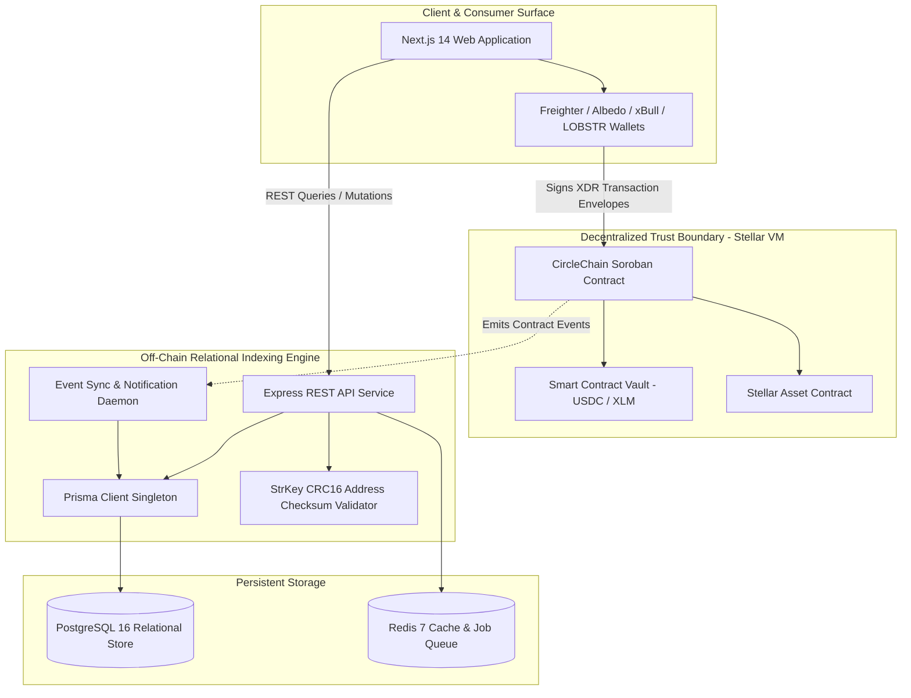
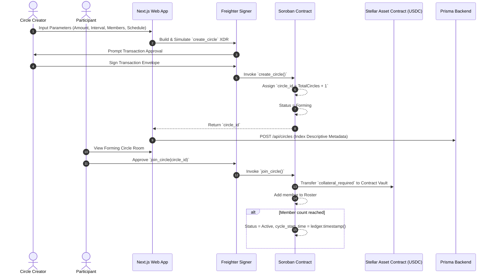
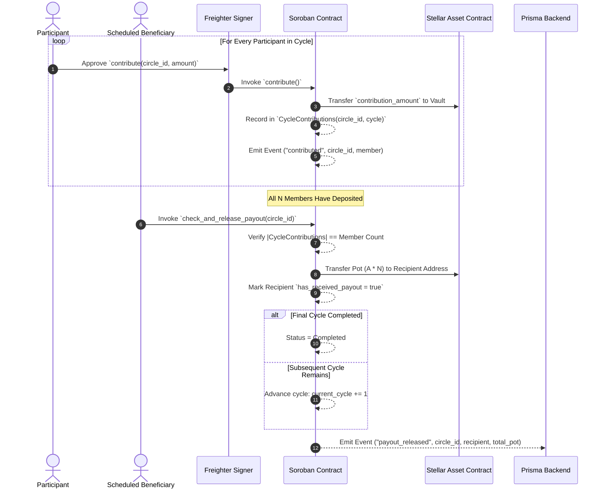

# CircleChain Protocol Architecture & Formal Specification 🏛️

This document provides the authoritative technical specification, storage layouts, state transition invariants, mathematical models, sequence diagrams, and error taxonomies for the CircleChain ROSCA protocol on Stellar & Soroban.

---

## 1. System Topology & Trust Isolation Boundary

CircleChain enforces **strict separation of concerns** between decentralized on-chain custody and off-chain indexing services:



### Architectural Guardrails & Invariants
1. **Financial Authority**: The Soroban smart contract is the sole authority for monetary state, collateral lockups, payout releases, cycle timer transitions, and slashing penalties.
2. **Non-Custodial Guarantee**: Zero private keys or secret seeds are ever stored, transmitted, or accessible to the API server or database. User authorizations require explicit cryptographic signing via `Address::require_auth()`.
3. **Database Boundary**: Prisma ORM + PostgreSQL 16 store purely descriptive off-chain metadata (circle titles, categorizations, notification subscriptions, and portable SBT reputation scores). The database **cannot authorize, trigger, or simulate fund movements**.

---

## 2. On-Chain Storage Slot Layout (Soroban Persistent Storage)

State on Soroban is mapped deterministically through persistent ledger storage using the `DataKey` enumeration:

```rust
#[derive(Clone)]
pub enum DataKey {
    Circle(u64),                            // Key: (Symbol("Circle"), circle_id) -> Circle struct
    Member(u64, Address),                   // Key: (Symbol("Member"), circle_id, Address) -> Member struct
    CycleContributions(u64, u32),           // Key: (Symbol("Cycle"), circle_id, cycle_index) -> Vec<Address>
    TotalCircles,                           // Key: Symbol("TotalCircles") -> u64
}
```

### 2.1 Storage Layout Matrix

| Storage Key | Slot Format | Storage Lifetime | Data Structure | Footprint / Max Size |
|---|---|---|---|---|
| `DataKey::TotalCircles` | `Symbol` | Persistent | `u64` | 8 bytes |
| `DataKey::Circle(id)` | `(Symbol, u64)` | Persistent | `Circle` struct | ~320 bytes |
| `DataKey::Member(id, addr)` | `(Symbol, u64, Address)` | Persistent | `Member` struct | ~128 bytes |
| `DataKey::CycleContributions(id, cycle)` | `(Symbol, u64, u32)` | Persistent | `Vec<Address>` | $32 \times N$ bytes ($N \le 20$) |

### 2.2 Core Struct Definitions

```rust
#[derive(Clone, Debug, PartialEq)]
pub struct Circle {
    pub id: u64,
    pub creator: Address,
    pub token_address: Address,
    pub contribution_amount: i128,          // in stroops (10^7)
    pub interval: u64,                      // cycle duration in seconds
    pub member_count: u32,                  // total required participants (3–20)
    pub collateral_required: i128,          // locked security deposit per member
    pub current_cycle: u32,                 // active cycle index (0-indexed)
    pub cycle_start_time: u64,              // ledger timestamp of current cycle start
    pub status: CircleStatus,               // Forming, Active, Completed, Defaulted
    pub payout_schedule: Vec<Address>,      // Ordered recipient schedule
}

#[derive(Clone, Debug, PartialEq)]
pub struct Member {
    pub address: Address,
    pub collateral_deposited: i128,
    pub has_received_payout: boolean,
    pub reputation_score: u32,              // 0–100 scale
}
```

---

## 3. Mathematical Models & Invariant Proofs

### 3.1 Pot Accumulation & Payout Invariant
For every cycle $c \in \{0, 1, \dots, N-1\}$, the exact payout pot disbursed to scheduled recipient $R_c$ is:
$$\text{Pot}_c = A \times N$$
Where:
- $A = \text{circle.contribution\_amount}$ (stroops per cycle)
- $N = \text{circle.member\_count}$ (total savers)

**Proof of Invariant Preservation**:
1. `contribute(circle_id, member, amount)` asserts $amount == A$.
2. The vector of paid members $\mathcal{P}_c$ enforces $\forall m \in \mathcal{P}_c, \text{count}(m) = 1$.
3. `check_and_release_payout(circle_id)` asserts $|\mathcal{P}_c| == N$.
4. Total tokens transferred from escrow to $R_c = A \times N$.
5. Escrow holds exactly $0$ residual tokens for cycle $c$ after disbursement.

### 3.2 Collateral Slashing & Grace Period Mechanics
Let $T_{\text{start}}$ be `cycle_start_time`, $\Delta t$ be `circle.interval`, and $G$ be `DEFAULT_GRACE_PERIOD_SECONDS` ($86,400\text{s}$ or $24\text{ hours}$).

The definitive default deadline $T_{\text{deadline}}$ is:
$$T_{\text{deadline}} = T_{\text{start}} + \Delta t + G$$

**Slashing Theorem**:
An invocation of `handle_default(circle_id, defaulter)` succeeds if and only if:
$$T_{\text{ledger}} > T_{\text{deadline}} \quad \land \quad \text{defaulter} \notin \mathcal{P}_c \quad \land \quad \text{member.collateral\_deposited} > 0$$
Upon execution:
$$\text{member.collateral\_deposited} \leftarrow 0, \quad \text{circle.status} \leftarrow \text{Defaulted}$$

---

## 4. End-to-End Core Sequence Diagrams

### 4.1 Flow 1: Circle Initialization & Collateral Staking



### 4.2 Flow 2: Cycle Contribution & Pot Release



---

## 5. Canonical Error Code Directory

| Error Code | Identifier | Triggering Condition | Recovery / Remediation Policy |
|---|---|---|---|
| `0x01` | `CircleNotFound` | Queried `circle_id` does not exist in storage | Verify ID against backend indexer |
| `0x02` | `CircleNotActive` | Contribution or slashing called on non-active pool | Ensure status is `Active` prior to invocation |
| `0x03` | `InvalidContributionAmount` | Deposited amount $\ne \text{circle.contribution\_amount}$ | Enforce exact token transfer matching pool spec |
| `0x04` | `DuplicateContribution` | Member attempts to contribute twice in same cycle | Prevent duplicate submission in UI layer |
| `0x05` | `GracePeriodNotExpired` | `handle_default` invoked before $T > T_{\text{deadline}}$ | Wait until $T_{\text{ledger}} > T_{\text{start}} + \Delta t + 86400$ |
| `0x06` | `NoCollateralAvailable` | Attempting to slash zero or already slashed collateral | Defaulter has already been penalized |
| `0x07` | `IncompleteContributions` | `check_and_release_payout` invoked prematurely | Await remaining participant deposits |
| `0x08` | `CircleNotCompleted` | `withdraw_collateral` called before pool completes | Collateral remains locked until all cycles finish |

---

## 6. Off-Chain Relational Data Schema (Prisma PostgreSQL 16)

```prisma
model CircleMetadata {
  circle_id           BigInt          @id
  name                String          @db.VarChar(255)
  description         String?
  category            String          @default("General Savings") @db.VarChar(100)
  creator_address     String          @db.VarChar(64)
  token_address       String          @default("USDC") @db.VarChar(64)
  contribution_amount Decimal         @default(100) @db.Decimal(20, 7)
  interval_days       Int             @default(7)
  member_count        Int             @default(5)
  collateral_required Decimal         @default(50) @db.Decimal(20, 7)
  payout_mode         String          @default("Fixed") @db.VarChar(50)
  status              String          @default("Forming") @db.VarChar(50)
  created_at          DateTime        @default(now()) @db.Timestamptz(6)
  updated_at          DateTime        @default(now()) @updatedAt @db.Timestamptz(6)

  members             CircleMember[]
  contributions       Contribution[]
  notifications       Notification[]
  reputation_logs     ReputationLog[]

  @@index([creator_address], name: "idx_circles_creator")
  @@index([status], name: "idx_circles_status")
  @@map("circles_metadata")
}
```

*(See [`backend/prisma/schema.prisma`](file:///c:/Users/Zion/Desktop/Ajo/backend/prisma/schema.prisma) for complete model specifications).*
