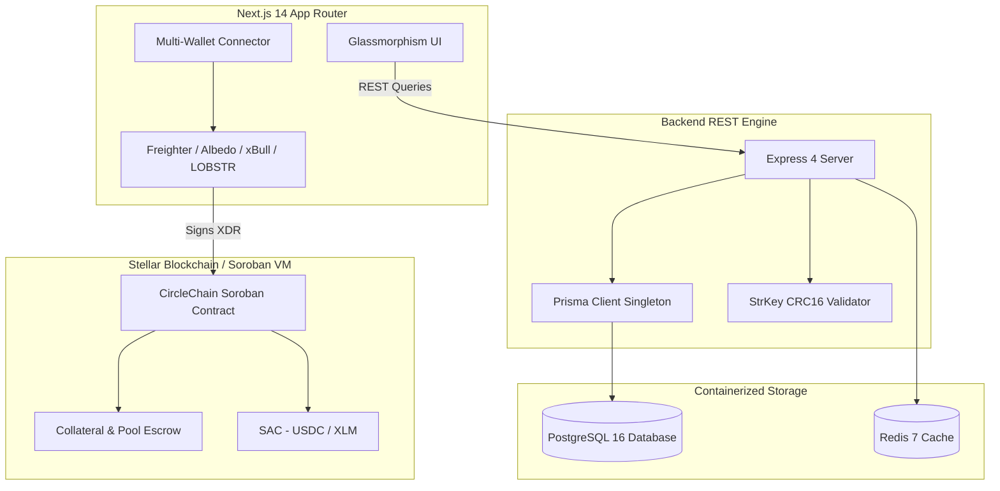

# CircleChain ⭕ (Ajo / Esusu on Stellar)

[](https://opensource.org/licenses/MIT)
[](https://github.com/trustpay-escrow/circle-chain/actions)
[](https://stellar.org)
[](https://www.prisma.io)
[-brightgreen.svg)](https://vitest.dev)
[](https://nodejs.org)
[](https://drips.network)

**CircleChain** is a production-grade, decentralized Rotating Savings and Credit Association (ROSCA) protocol built on the **Stellar blockchain** using **Soroban Rust smart contracts**, **Prisma ORM (PostgreSQL 16)**, **Redis 7**, and **Next.js 14 (App Router)**.

---

## 📌 Problem Statement

In emerging economies (particularly across West Africa, East Africa, and Latin America), over 350 million adults participate in informal community savings groups known as **Ajo**, **Esusu**, **Tandas**, or **Chamas**. Despite moving billions of dollars annually, these traditional ROSCA pools face critical challenges:
1. **Default & Flight Risk**: Early pot recipients frequently default on subsequent cycle contributions without recourse.
2. **Opaque Bookkeeping**: Manual paper ledgers create disputes over contribution timings and payout sequence orders.
3. **Zero Financial Inclusion**: Prompt savers build no portable credit history or verifiable financial reputation.
4. **Physical Cash Vulnerability**: In-person cash collection creates theft and security risks for community coordinators.

---

## 💡 The CircleChain Solution

CircleChain elevates communal savings into a cryptographic, non-custodial Web3 protocol:
- **Non-Custodial Escrow on Soroban**: Collateral deposits and cycle contributions are held strictly in audited smart contracts (`contracts/src/lib.rs`).
- **Automated Collateral Slashing**: Defaulters have their staked security deposit automatically slashed to protect other group participants.
- **Enterprise Relational Indexer**: Prisma ORM + PostgreSQL 16 index descriptive pool data, activity timelines, and notifications.
- **Cryptographic Address Verification**: Enforces StrKey RFC 4648 Base32 decoding and CRC16-XMODEM checksum validation.
- **Soulbound Reputation Scoring (SBT)**: On-time contributions build portable credit reputation (0–100 score).

---

## 🏛 System Architecture



---

## 🏗 Repository Structure

```text
circle-chain/
├── .github/workflows/
│   └── ci.yml                 # Automated CI (Rust tests, Prisma client, Vitest, Next build)
├── contracts/                 # Soroban Smart Contract (Rust Wasm)
│   ├── Cargo.toml             # Soroban SDK dependencies
│   └── src/
│       ├── lib.rs             # Public contract entrypoints (create, join, contribute, payout, slash)
│       └── test.rs            # 100% passing contract unit tests
├── backend/                   # Express REST API & Prisma Engine
│   ├── prisma/
│   │   ├── schema.prisma      # PostgreSQL schema (CircleMetadata, UserProfile, Member, Contribution)
│   │   └── seed.ts            # Local database seeding script
│   ├── src/
│   │   ├── lib/
│   │   │   ├── prisma.ts      # Prisma Client singleton with connection pooling & fallbacks
│   │   │   └── stellar-validator.ts # Cryptographic StrKey CRC16-XMODEM address validator
│   │   ├── routes/            # REST endpoints (/circles, /profiles, /contributions, /notifications)
│   │   ├── server.ts          # Express entrypoint with /health/liveness and /health/readiness probes
│   │   └── test/              # Vitest test suite for backend routes & cryptographic validator
│   └── vitest.config.ts       # Backend Vitest configuration
├── frontend/                  # Next.js 14 App Router Web App
│   ├── app/                   # Routes (/circles, /circles/create, /profile)
│   ├── components/            # UI components (ContributionGrid, Navbar, WalletModal)
│   ├── lib/                   # Stellar SDK & API client integration helpers
│   ├── test/                  # Test setup & mocks
│   └── vitest.config.ts       # Frontend component test runner
├── docs/                      # Comprehensive Architecture Documentation
│   ├── COMPONENTS.md          # Complete directory of UI components and roles
│   ├── STATE_ARCHITECTURE.md  # State flow, wallet context, and non-custodial invariants
│   ├── CONTRACT_CALLS.md      # Detailed map of every Soroban contract call & RPC schema
│   ├── ENVIRONMENT.md         # Exhaustive environment variables guide
│   └── drips-wave-issues.json # 42 structured engineering issues (7,250 points allocated)
├── scripts/
│   ├── seed-and-verify.ts     # 1-command reviewer Friendbot Testnet verification script
│   └── publish-drips-issues.ts # Automated GitHub issue publisher CLI
├── docker-compose.yml         # Local stack (PostgreSQL 16, Redis 7, Backend, Frontend)
├── FUNDING.json               # Drips protocol verified payout address configuration
├── ENVIRONMENT.md             # Root environment guide
├── CHANGELOG.md               # Version history and feature track record
├── CONTRIBUTING.md            # Contributor guidelines & PR conventions
├── SECURITY.md                # Non-custodial security policy
└── LICENSE                    # OSI-approved MIT License
```

---

## ⚡ Quick Start & Reviewer Verification Guide

Reviewers can verify the full repository in 4 simple commands:

### 1. Install Dependencies
```bash
# Backend dependencies
npm --prefix backend install --legacy-peer-deps

# Frontend dependencies
npm --prefix frontend install --legacy-peer-deps
```

### 2. Run Automated Test Suites
```bash
# Run backend Vitest test suite (16 tests covering StrKey CRC16, Prisma routing, probes)
npm test

# Run frontend Vitest component test suite
npm --prefix frontend test

# Run Soroban smart contract tests
npm run test:contracts
```

### 3. Start Local Container Stack (PostgreSQL 16 + Redis 7)
```bash
docker-compose up -d
```

### 4. Run 1-Command Live Testnet Verification Script
```bash
npm run verify
```
*This command generates an authentic Stellar keypair, calls Stellar Friendbot to fund it with 10,000 Testnet XLM, verifies ledger confirmation via Horizon RPC, and performs database ingestion through the Prisma backend.*

---

## 🤝 Drips Wave Grant Alignment

- **Grant Qualification Matrix**: Detailed in [`SUBMISSION.md`](file:///c:/Users/Zion/Desktop/Ajo/SUBMISSION.md).
- **Verified Protocol Address**: Configured in [`FUNDING.json`](file:///c:/Users/Zion/Desktop/Ajo/FUNDING.json).
- **Task Backlog**: 42 scoped engineering issues ready for community developers in [`docs/drips-wave-issues.json`](file:///c:/Users/Zion/Desktop/Ajo/docs/drips-wave-issues.json).
- **Architecture Specifications**: In [`ARCHITECTURE.md`](file:///c:/Users/Zion/Desktop/Ajo/ARCHITECTURE.md) and [`docs/STATE_ARCHITECTURE.md`](file:///c:/Users/Zion/Desktop/Ajo/docs/STATE_ARCHITECTURE.md).

---

## 📄 License

This project is licensed under the [MIT License](file:///c:/Users/Zion/Desktop/Ajo/LICENSE).
