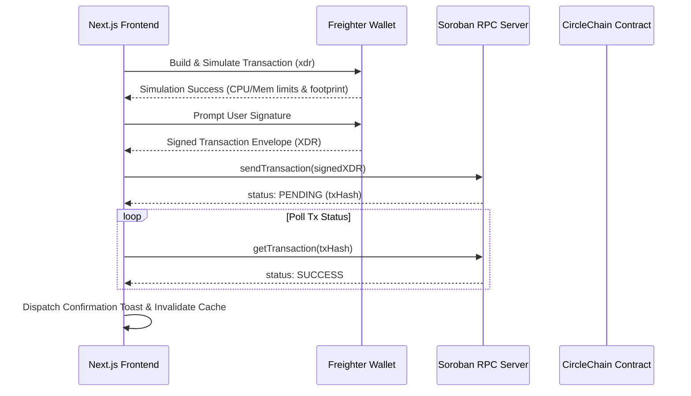

# CircleChain Soroban Smart Contract & Web3 API Map ⛓️

This document provides a comprehensive mapping of every on-chain smart contract method, cryptographic authentication requirement, and RPC payload in CircleChain.

---

## 1. Network Specifications

| Parameter | Testnet | Futurenet | Mainnet Target |
|---|---|---|---|
| **Network Passphrase** | `Test SDF Network ; September 2015` | `Test SDF Future Network ; October 2022` | `Public Global Stellar Network ; September 2015` |
| **RPC Endpoint** | `https://soroban-testnet.stellar.org` | `https://rpc-futurenet.stellar.org` | Dedicated Private RPC Node |
| **Horizon Endpoint** | `https://horizon-testnet.stellar.org` | `https://horizon-futurenet.stellar.org` | `https://horizon.stellar.org` |
| **Wasm File** | `target/wasm32-unknown-unknown/release/circlechain.wasm` | `target/...` | Audited Production Wasm |

---

## 2. Soroban Contract Invocations (`contracts/src/lib.rs`)

### 2.1 `create_circle`
- **Purpose**: Initializes a new peer-to-peer ROSCA savings pool with deterministic schedule.
- **Access Control**: Invoker must sign transaction (`creator.require_auth()`).
- **Signature**:
  ```rust
  pub fn create_circle(
      env: Env,
      creator: Address,
      token_address: Address,
      contribution_amount: i128,
      interval: u64,
      member_count: u32,
      collateral_required: i128,
      payout_schedule: Vec<Address>,
  ) -> u64
  ```
- **Parameters**:
  - `creator`: Stellar Address initiating the circle.
  - `token_address`: Soroban SAC (Stellar Asset Contract) address (e.g. USDC or native XLM).
  - `contribution_amount`: Amount in stroops (`10^7`) due per cycle.
  - `interval`: Duration of each cycle in seconds (e.g. `604800` for 7 days).
  - `member_count`: Required number of participants (3–20).
  - `collateral_required`: Security deposit locked per member.
  - `payout_schedule`: Ordered vector of payout recipient addresses.
- **Returns**: Unique `u64` `circle_id`.

---

### 2.2 `join_circle`
- **Purpose**: Registers a participant in a forming circle and locks their collateral into escrow.
- **Access Control**: Member signs transaction (`member_address.require_auth()`).
- **Signature**:
  ```rust
  pub fn join_circle(env: Env, circle_id: u64, member_address: Address)
  ```
- **State Transition**:
  - Validates circle status is `Forming`.
  - Checks circle is not full (`members.len() < member_count`).
  - Transfers `collateral_required` from `member_address` into contract address.
  - Transitions circle status to `Active` when last member joins.

---

### 2.3 `contribute`
- **Purpose**: Deposits the periodic contribution for the current active cycle.
- **Access Control**: Member signs transaction (`member_address.require_auth()`).
- **Signature**:
  ```rust
  pub fn contribute(env: Env, circle_id: u64, member_address: Address, amount: i128)
  ```
- **State Transition**:
  - Enforces `amount == contribution_amount`.
  - Transits token from member to contract escrow.
  - Emits Soroban event `(Symbol::new(&env, "contributed"), circle_id, member_address, cycle_index)`.

---

### 2.4 `check_and_release_payout`
- **Purpose**: Releases accumulated cycle pot to the scheduled recipient once all members have contributed.
- **Access Control**: Open invocation (anyone can trigger once criteria are satisfied).
- **Signature**:
  ```rust
  pub fn check_and_release_payout(env: Env, circle_id: u64)
  ```
- **State Transition**:
  - Verifies `total_cycle_contributions == member_count * contribution_amount`.
  - Transfers pot to `payout_schedule[current_cycle]`.
  - Increments `current_cycle`. If `current_cycle == member_count`, unlocks all collateral and marks circle `Completed`.

---

### 2.5 `handle_default`
- **Purpose**: Slashes collateral of a defaulted saver who fails to deposit before the cycle grace period expires.
- **Access Control**: Validates `env.ledger().timestamp() > cycle_deadline`.
- **Signature**:
  ```rust
  pub fn handle_default(env: Env, circle_id: u64, defaulter: Address)
  ```
- **State Transition**:
  - Slashes defaulter's staked collateral to cover the pot deficit.
  - Compensates non-defaulting participants.
  - Flags defaulter profile for negative reputation audit.

---

## 3. Web3 Transaction Pipeline


