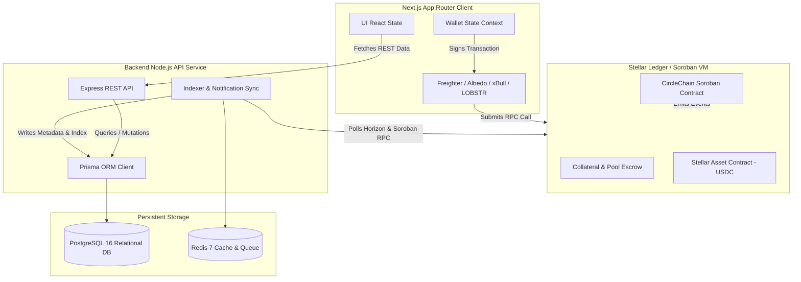
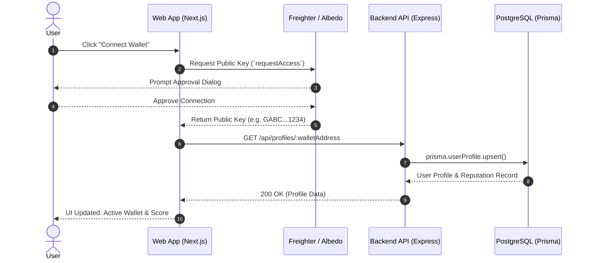

# CircleChain State & Protocol Architecture 🏛️

This document details the state lifecycle, non-custodial cryptographic guarantees, and data synchronization flow between the Stellar ledger, backend Prisma ORM (PostgreSQL), and the client application.

---

## 1. Architectural Principles

CircleChain enforces **strict separation** between immutable financial state and mutable descriptive state:

1. **On-Chain Soroban Smart Contracts**:
   - Sole authority for fund custody, collateral lockups, cycle progression, payout execution, and slashing.
   - Non-custodial: only the user's private key via their wallet can sign transactions.
2. **Off-Chain Prisma ORM (PostgreSQL)**:
   - Indexes circle human-readable metadata (names, descriptions, avatars, categories).
   - Tracks off-chain notifications, cycle reminders, and portable reputation telemetry.
   - **Guaranteed invariant**: Database never stores private keys, seeds, or authorization signatures.
3. **Client-Side State**:
   - Reactive wallet provider context tracking public key, network identifier, and active connection status.

---

## 2. Multi-Layer State Topology

---

## 3. State Invariants & Non-Custodial Guarantees

| Concern | On-Chain (Soroban) | Off-Chain (Prisma + PostgreSQL) |
|---|---|---|
| **Funds & Escrow** | `i128` balance locked in Soroban contract address | Never holds balances. Only logs amounts for UX |
| **Collateral Slashing** | Executed in Rust contract (`handle_default`) | Receives audit log event post-execution |
| **Identity & Keys** | Verified via `Address::require_auth()` | Stores public key (`G...`) with StrKey CRC16 validation |
| **Cycle Transitions** | Enforced strictly by timestamp comparison (`env.ledger().timestamp()`) | Indexed for UI countdowns & notifications |

---

## 4. Wallet Connection Flow

---

## 5. Offline & High-Availability Resilience

- **Prisma Connection Pooling**: Configured with automated retry handlers and graceful health probe reporting (`/health`).
- **Client Cache**: Next.js App Router leverages server caching with stale-while-revalidate for read performance.
- **Failover Safe**: If the backend database is unreachable during maintenance, the client falls back to read-only direct Soroban contract RPC queries.
