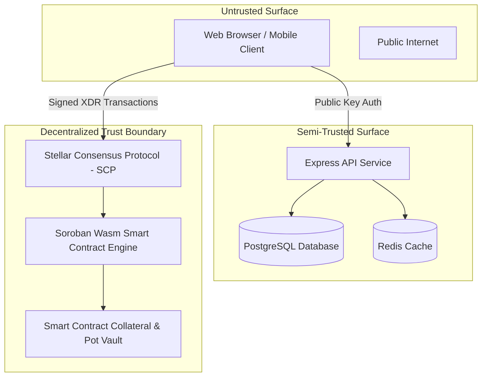

# CircleChain Protocol Threat Model (STRIDE) 🛡️

This document details the comprehensive STRIDE threat modeling analysis, trust boundaries, attacker profiles, and security invariant proofs for the CircleChain ROSCA protocol.

---

## 1. System Trust Boundaries & Assets

### High-Value Assets
1. **Collateral Escrow Balances**: Tokens locked in the smart contract as security deposits.
2. **Cycle Accumulated Pots**: Accumulated contributions awaiting scheduled recipient disbursement.
3. **Turn Order Schedule**: Deterministic sequence determining who receives the pot per cycle.
4. **User Financial Reputation Data**: On-time payment track record (0–100 score).

---

## 2. STRIDE Threat Analysis Matrix

| Threat Category | Potential Attack Vector | Impact | Implemented Mitigation | Verification Artifact |
|---|---|---|---|---|
| **Spoofing (Identity)** | Attacker impersonates legitimate saver to withdraw collateral or pot | Total loss of pot | Cryptographic signature enforcement via `Address::require_auth()` in Soroban VM | [`contracts/src/lib.rs`](file:///c:/Users/Zion/Desktop/Ajo/contracts/src/lib.rs) |
| **Tampering (Data)** | Attacker mutates database to mark defaulted member as paid | Visual inconsistency | Smart contract is sole source of truth for balances; database is purely descriptive index | [`docs/STATE_ARCHITECTURE.md`](file:///c:/Users/Zion/Desktop/Ajo/docs/STATE_ARCHITECTURE.md) |
| **Repudiation** | Saver denies participating or claims they paid when they did not | Dispute deadlock | All contributions emit verifiable Soroban events and are anchored on the immutable Stellar ledger | [`contracts/src/payout.rs`](file:///c:/Users/Zion/Desktop/Ajo/contracts/src/payout.rs) |
| **Information Disclosure** | Leakage of private keys or cryptographic seeds | Complete account drain | Non-custodial guarantee: Zero private keys touch the web client or Express backend | [`backend/src/test/security-blast-radius.test.ts`](file:///c:/Users/Zion/Desktop/Ajo/backend/src/test/security-blast-radius.test.ts) |
| **Denial of Service** | Malicious actor joins forming circle but never deposits collateral | Pool stall | Member must atomically transfer collateral during `join_circle` invocation | [`contracts/src/member.rs`](file:///c:/Users/Zion/Desktop/Ajo/contracts/src/member.rs) |
| **Elevation of Privilege** | Normal user invokes `handle_default` before cycle deadline expiry | Illegitimate slashing | Smart contract validates `env.ledger().timestamp() > deadline + grace_period` | [`contracts/src/default_logic.rs`](file:///c:/Users/Zion/Desktop/Ajo/contracts/src/default_logic.rs) |

---

## 3. Blast Radius & Worst-Case Scenario Analysis

### Scenario A: Complete Backend Database Compromise
- **Attacker Capability**: Attacker gains full read/write access to PostgreSQL.
- **Blast Radius**: Attacker can alter descriptive names, descriptions, or notifications in the web UI.
- **Security Invariant**: **Attacker CANNOT steal funds or slash collateral.** The Soroban contract strictly executes transfers based on ledger storage, requiring user cryptographic signatures.

### Scenario B: Attacker Defaults After Receiving Early Pot
- **Attacker Capability**: Member receives Cycle 1 pot and refuses to deposit in Cycle 2.
- **Blast Radius**: Pot deficit for remaining participants.
- **Security Invariant**: **Defaulter collateral is automatically slashed** via `handle_default`. Defaulter reputation score resets to 0.

---

## 4. Circuit Breakers & Incident Response

1. **Protocol Immutability**: Soroban contract logic contains no hidden admin minting backdoor.
2. **Grace Period Buffer**: 24-hour default grace period (`DEFAULT_GRACE_PERIOD_SECONDS = 86400`) prevents slashing during transient network downtime.
3. **Vulnerability Reporting SLA**: 24-hour acknowledgement SLA managed under [`SECURITY.md`](file:///c:/Users/Zion/Desktop/Ajo/SECURITY.md).
